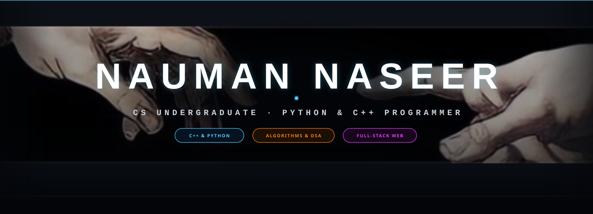
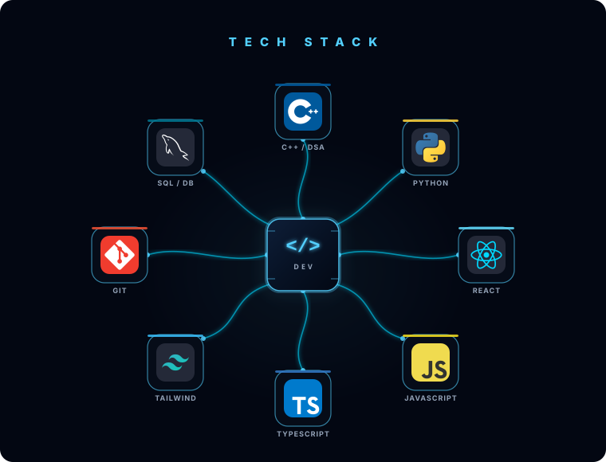

<!-- ═══════════════════════════════════════════════════════════════════
     HERO BANNER — Michelangelo Hands Background with Name Overlay
     ═══════════════════════════════════════════════════════════════════ -->

  

<h5><i class="rich-diff-level-one">Computer Science undergraduate student passionate about core computing, systems programming, algorithmic problem-solving, and building practical software solutions.</i></h5>

 

<!-- Integrated Quick Action Bar (Clickable Links) -->

  
  &nbsp;
  
  &nbsp;
  
  &nbsp;
  
  &nbsp;
  

  

<!-- ═══════════════════════════════════════════════════════════════════
     TECH STACK — SPIDER HUB GRAPH (Tools I Used)
     ═══════════════════════════════════════════════════════════════════ -->

  

  

<!-- ═══════════════════════════════════════════════════════════════════
     CONTRIBUTION ANALYTICS & ACTIVITY
     ═══════════════════════════════════════════════════════════════════ -->

## 📊 Contribution Analytics

<table border="0" cellpadding="0" cellspacing="0" style="border: 0; border-collapse: separate; width: 100%;">
  <tr style="border: 0;">
    <td align="center" valign="top" style="border: 0; padding: 0 8px;">
      
    </td>
    <td align="center" valign="top" style="border: 0; padding: 0 8px;">
      
    </td>
  </tr>
</table>

<table border="0" cellpadding="0" cellspacing="0" style="border: 0; border-collapse: separate; width: 100%;">
  <tr style="border: 0;">
    <td align="center" valign="top" style="border: 0; padding: 0 8px;">
      
    </td>
    <td align="center" valign="top" style="border: 0; padding: 0 8px;">
      
    </td>
  </tr>
</table>

 

  

  

<!-- ═══════════════════════════════════════════════════════════════════
     FEATURED PROJECTS
     ═══════════════════════════════════════════════════════════════════ -->

## 🚀 Featured Projects

<table border="0" cellpadding="0" cellspacing="0" style="border: 0; border-collapse: separate; width: 100%;">
  <tr style="border: 0;">
    <td width="50%" valign="top" style="border: 0; padding: 12px;">
      <h3>⚡ Personal Developer Portfolio</h3>
      
Modern responsive portfolio website built with clean architecture, interactive UI animations, and dark mode.

      
<b>Tech:</b> <code>React</code> · <code>Tailwind CSS</code> · <code>JavaScript</code> · <code>Vercel</code>

      

        <a href="https://github.com/devnoumannaseer-ctrl/Portfolio-Nauman-Naseer"><b>View Repository →</b></a> &nbsp;|&nbsp;
        <a href="https://portfolio-nauman-naseer.vercel.app/" target="_blank"><b>Live Demo 🌐</b></a>
      

    </td>
    <td width="50%" valign="top" style="border: 0; padding: 12px;">
      <h3>🍽️ Fonro Restaurant Web Platform</h3>
      
Full-featured modern restaurant web application with interactive dynamic menu navigation, table reservations, and cart workflow.

      
<b>Tech:</b> <code>React</code> · <code>JavaScript</code> · <code>CSS3</code> · <code>Vercel</code>

      

        <a href="https://github.com/devnoumannaseer-ctrl/Fonro-resturant"><b>View Repository →</b></a> &nbsp;|&nbsp;
        <a href="https://fonro-resturant.vercel.app/" target="_blank"><b>Live Demo 🌐</b></a>
      

    </td>
  </tr>
  <tr style="border: 0;">
    <td width="50%" valign="top" style="border: 0; padding: 12px;">
      <h3>🧠 Algorithm & Data Structures Visualizer</h3>
      
Interactive algorithm visualizer demonstrating sorting, pathfinding, and tree traversal algorithms with step-by-step state animations.

      
<b>Tech:</b> <code>C++</code> · <code>Python</code> · <code>DSA</code> · <code>Algorithms</code>

      

        <a href="https://github.com/devnoumannaseer-ctrl/Algorithm-Visualizer"><b>View Repository →</b></a>
      

    </td>
    <td width="50%" valign="top" style="border: 0; padding: 12px;">
      <h3>🎓 Student Record Management System</h3>
      
Robust C++ application featuring file persistence, memory management, and structured search/sorting algorithms for institutional academic records.

      
<b>Tech:</b> <code>C++</code> · <code>OOP</code> · <code>File I/O</code> · <code>Data Structures</code>

      

        <a href="https://github.com/devnoumannaseer-ctrl/Student-Record-System"><b>View Repository →</b></a>
      

    </td>
  </tr>
  <tr style="border: 0;">
    <td width="100%" colspan="2" valign="top" style="border: 0; padding: 12px;">
      <h3>🐍 Python Automation & Productivity Suite</h3>
      
Multi-tool Python utility suite providing automated file organization, batch processing, scraping, and workflow enhancements.

      
<b>Tech:</b> <code>Python</code> · <code>Automation</code> · <code>OS Scripting</code> · <code>RegEx</code>

      

        <a href="https://github.com/devnoumannaseer-ctrl/Python-Automation-Suite"><b>View Repository →</b></a>
      

    </td>
  </tr>
</table>

  

<!-- ═══════════════════════════════════════════════════════════════════
     FOOTER
     ═══════════════════════════════════════════════════════════════════ -->

  

